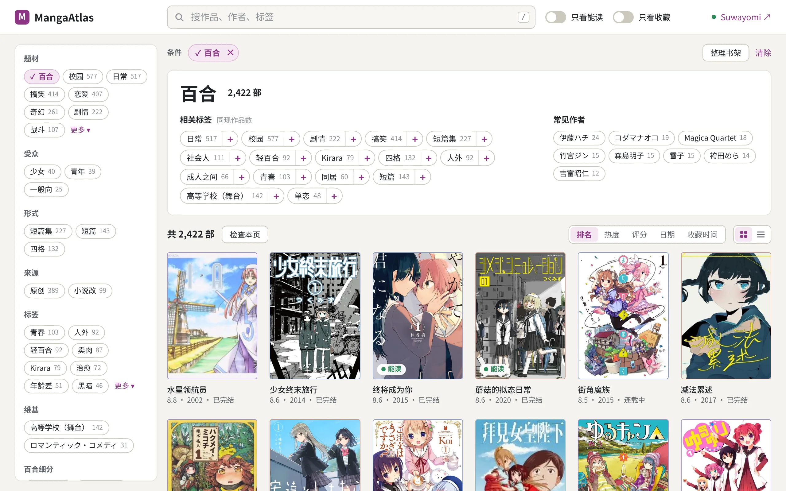
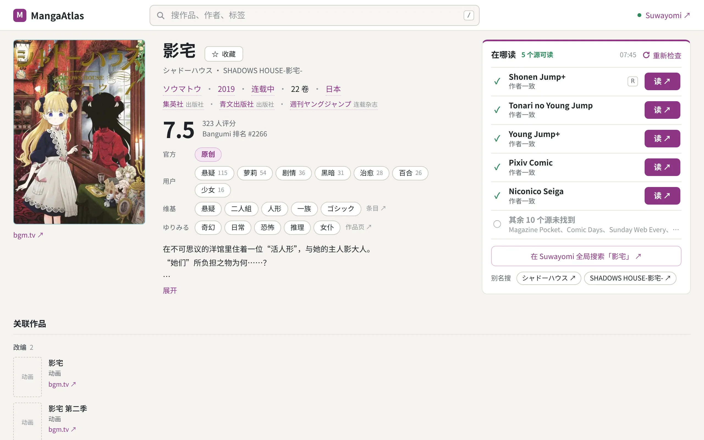
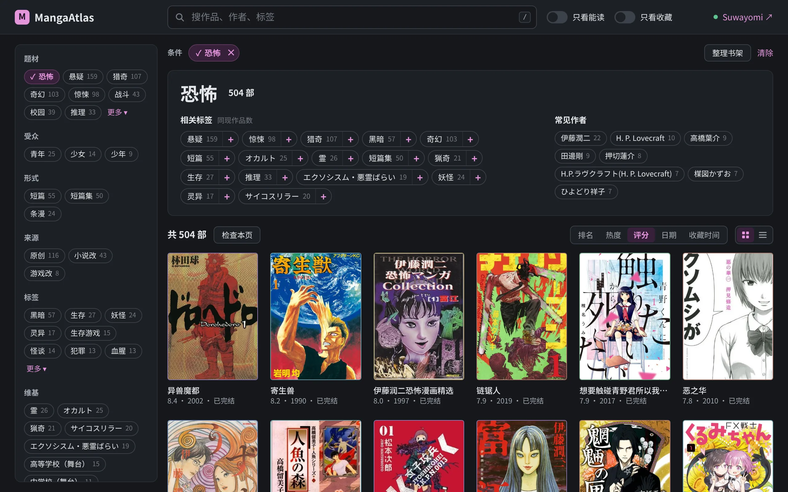

# MangaAtlas

**English** | [简体中文](README.zh-CN.md)

[](https://github.com/BANANASJIM/manga-atlas/actions/workflows/ci.yml)
[](LICENSE)


Find manga by [Bangumi](https://bgm.tv)'s tags, scores, authors and years, see which of your
[Suwayomi](https://github.com/Suwayomi/Suwayomi-Server) sources carry a work, and open it there to read.



MangaAtlas is a local web app for one person. It builds a catalogue of about 60,000 manga into
SQLite from the [Bangumi Archive](https://github.com/bangumi/Archive), which Bangumi publishes every
week, adds tags from
Japanese Wikipedia and [ゆりみる](https://www.yurimiru.com), and searches it as you type. Reading
stays in Suwayomi: for each work MangaAtlas asks the Suwayomi sources you choose whether they have
it, and one click opens it in Suwayomi.

The interface is in Chinese.

## Features

- **Search as you type**: titles in Chinese (Simplified or Traditional), Japanese or any alias;
  tags to include or exclude (`#百合 -#恐怖`), authors (`作者:`), year, status, region and minimum
  score. Sort by rank, popularity, score, date or when you added a favorite. Facet counts follow
  every change, and every view is a URL, so a bookmark is a saved search.
- **Where to read (在哪读)**: the work page asks every configured source and marks each one ✓
  (the same work) or ≈ (probably the same work, for example under another translation but with
  the same author). 只看能读 keeps the works some source is known to carry; 检查本页 checks a whole
  page of results.
- **Read in Suwayomi**: one click opens the work in Suwayomi, fetching its chapters first if needed.
- **Favorites (收藏)**, kept on your machine: ☆ on the work page or <kbd>F</kbd>; filter and sort by them.
- **Organize your library (整理书架)**: file Suwayomi library entries into categories named after
  Bangumi tags. It shows a preview first, writes only when you press 应用, and never removes anything.
- **Keyboard**: <kbd>/</kbd> search, <kbd>↑</kbd> <kbd>↓</kbd> pick a work, <kbd>Enter</kbd> open it,
  <kbd>R</kbd> read, <kbd>←</kbd> <kbd>→</kbd> previous or next work, <kbd>F</kbd> favorite.
- Light and dark themes follow your system.





## Requirements

- Python 3.12 or newer and [uv](https://docs.astral.sh/uv/).
- A running [Suwayomi-Server](https://github.com/Suwayomi/Suwayomi-Server) with the extensions for
  the sources you want checked. MangaAtlas never installs extensions.
- About 700 MB of disk: the latest archive (about 450 MB), the catalogue (90 MB) and the covers you view.

## Quick start

```sh
git clone https://github.com/BANANASJIM/manga-atlas.git
cd manga-atlas
uv sync
uv run manga-atlas build    # download the latest Bangumi Archive and build the catalogue
uv run manga-atlas serve    # then open http://127.0.0.1:4568
```

The catalogue itself builds in about a minute after the download. The first build also fetches
Japanese Wikipedia categories (about 40 minutes) and ゆりみる's tags (about 2 hours); later builds
refresh them once a month, ゆりみる only for pages that changed. To skip either, set
`jawiki_enabled = false` or `yurimiru_enabled = false` in the config file.

By default MangaAtlas checks only the publishers' own Japanese sites. To check other sources, copy
[`config.example.toml`](config.example.toml) to `~/.config/manga-atlas/config.toml` and edit its
`sources`. See [Configuration](docs/configuration.md).

## Run as a service (Linux)

The units in [`deploy/`](deploy) run the web app from login on, and optionally rebuild the
catalogue every Wednesday, after the Bangumi Archive's weekly release.

```sh
uv tool install .          # puts the manga-atlas command in ~/.local/bin
mkdir -p ~/.config/systemd/user
cp deploy/manga-atlas.service deploy/manga-atlas-build.* ~/.config/systemd/user/
systemctl --user daemon-reload
systemctl --user enable --now manga-atlas.service       # http://127.0.0.1:4568
systemctl --user enable --now manga-atlas-build.timer   # optional weekly rebuild
```

After a `git pull`, run `uv tool install --reinstall .` and `systemctl --user restart manga-atlas`.
To start at boot rather than at login, run `loginctl enable-linger`.

## How it works

`manga-atlas build` turns the archive into a read-only `atlas.db`. The web app searches it, and
keeps its own `state.db` for what it learns from Suwayomi (which source has which work) and your
favorites. It reaches manga sources only through Suwayomi, which does the actual fetching; it never
sends two requests to one source at once, spaces them out, and caches the answers.
[Architecture](docs/architecture.md) has the details, including how titles are matched.

## Data sources and credits

| Source | What MangaAtlas uses | Terms |
| --- | --- | --- |
| [Bangumi](https://bgm.tv) via the [Bangumi Archive](https://github.com/bangumi/Archive) | Works, tags, scores, people, relations; covers from the Bangumi API | The archive ships no license; it is downloaded to your machine and not redistributed |
| [Wikidata](https://www.wikidata.org) | Links from Bangumi IDs to Wikipedia articles, Chinese titles | CC0 |
| [Japanese Wikipedia](https://ja.wikipedia.org) | Article categories as extra tags, linked from the work page | CC BY-SA 4.0 |
| [ゆりみる](https://www.yurimiru.com) | Its editors' tags for yuri manga, fetched slowly and following robots.txt | Tags only; comments and texts are not stored |
| [OpenCC](https://github.com/BYVoid/OpenCC) | Traditional-to-Simplified conversion, and its Shinjitai table in `src/manga_atlas/match/data` | Apache-2.0 |

Manga sources are the Suwayomi extensions you install yourself. MangaAtlas ships none of them and is
not affiliated with any.

## Scope

One person, one machine. There are no accounts, no Bangumi account sync, no R18 works, no mobile
layout and no network access from other devices. Reading itself is Suwayomi's job.

## Contributing and security

See [CONTRIBUTING.md](CONTRIBUTING.md) to set up a development copy and run the checks.
MangaAtlas has no authentication, so keep it on `127.0.0.1`; [SECURITY.md](SECURITY.md) explains
why and how to report a vulnerability.

## License

[MIT](LICENSE). Data from the sources above keeps its own terms.
