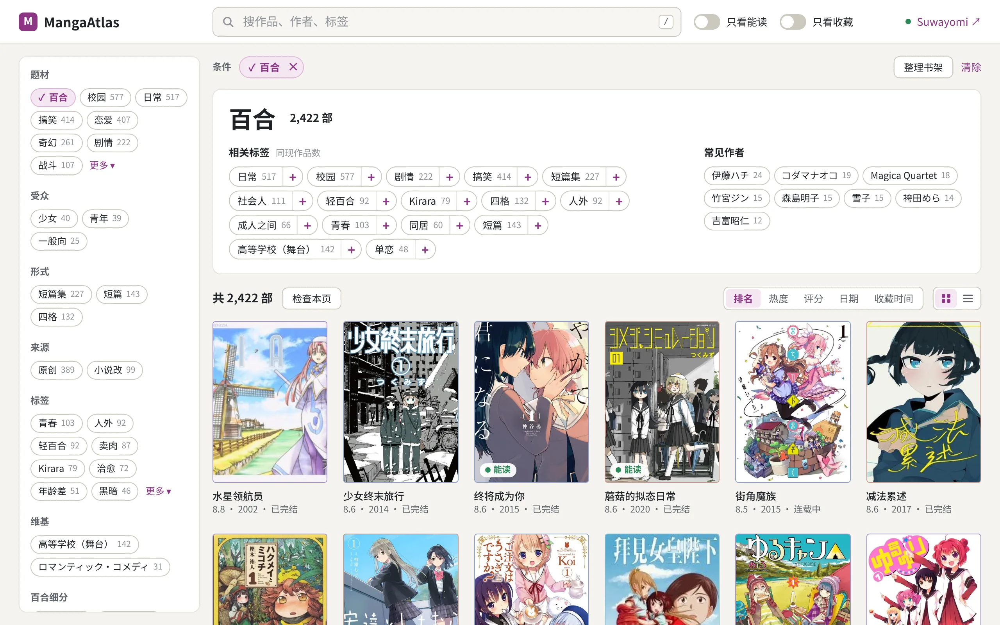
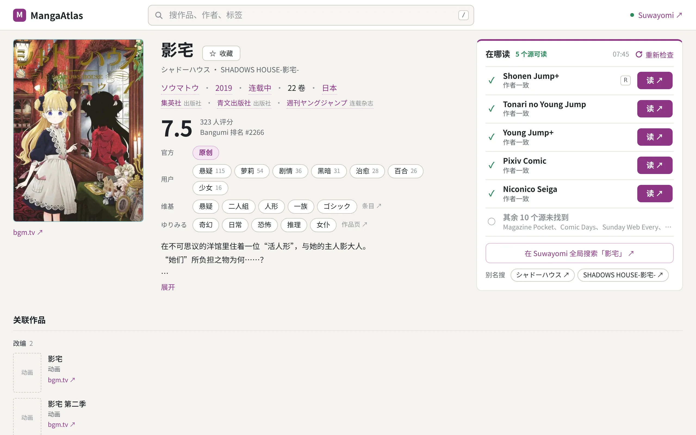
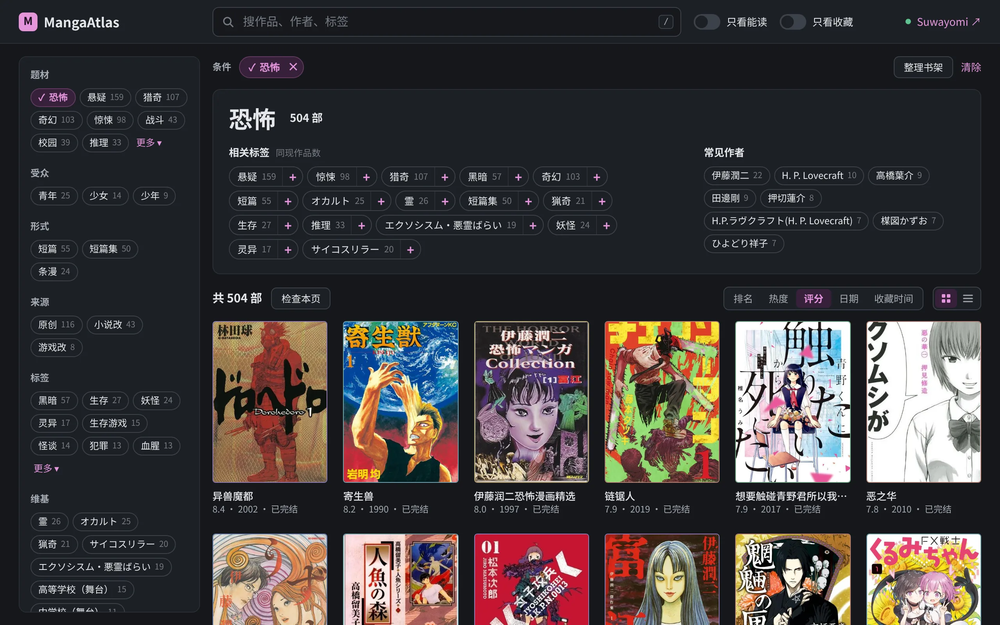

# MangaAtlas

[English](README.md) | **简体中文**

[](https://github.com/BANANASJIM/manga-atlas/actions/workflows/ci.yml)
[](LICENSE)


按 [Bangumi](https://bgm.tv) 的标签、评分、作者和年份找漫画，看看你的 [Suwayomi](https://github.com/Suwayomi/Suwayomi-Server) 源里哪些收录了某部作品，并在 Suwayomi 里打开阅读。



MangaAtlas 是单人使用的本地 Web 应用。它从 Bangumi 每周发布的 [Bangumi Archive](https://github.com/bangumi/Archive) 数据包构建一份约 6 万部漫画的目录，存入 SQLite，补充来自日文维基百科和 [ゆりみる](https://www.yurimiru.com) 的标签，并在你输入时即时搜索。阅读仍在 Suwayomi 里进行：对每部作品，MangaAtlas 会询问你选定的 Suwayomi 源有没有它，点一下就能在 Suwayomi 里打开。

界面是中文的。

## 功能

- **边输边搜**：可按中文（简体或繁体）标题、日文标题或任意别名搜索；可包含或排除标签（`#百合 -#恐怖`），也可按作者（`作者:`）、年份、状态、地区和最低评分筛选。可按排名、热度、评分、日期或收藏时间排序。分面计数随每次改动同步更新，每个视图都是一个 URL，所以书签就是保存下来的搜索。
- **在哪读**：作品页会询问每个已配置的源，并分别标上 ✓（同一部作品）或 ≈（很可能是同一部作品，例如译名不同但作者一致）。「只看能读」只保留已知有某个源收录的作品；「检查本页」会检查整页结果。
- **在 Suwayomi 里阅读**：点一下就在 Suwayomi 里打开作品，必要时会先获取它的章节。
- **收藏**，保存在本机：在作品页点 ☆ 或按 <kbd>F</kbd>；可按收藏筛选和排序。
- **整理书架**：把 Suwayomi 书架里的漫画归入以 Bangumi 标签命名的分类。它会先给出预览，只在你点击「应用」时才写入，并且从不删除任何东西。
- **键盘**：<kbd>/</kbd> 搜索，<kbd>↑</kbd> <kbd>↓</kbd> 选择作品，<kbd>Enter</kbd> 打开，<kbd>R</kbd> 阅读，<kbd>←</kbd> <kbd>→</kbd> 上一部或下一部，<kbd>F</kbd> 收藏。
- 浅色和深色主题会跟随系统。





## 环境要求

- Python 3.12 或更高版本，以及 [uv](https://docs.astral.sh/uv/)。
- 一个正在运行的 [Suwayomi-Server](https://github.com/Suwayomi/Suwayomi-Server)，并装好你想检查的那些源所对应的扩展。MangaAtlas 从不安装扩展。
- 约 700 MB 磁盘空间：最新的数据包（约 450 MB）、目录（90 MB）和你浏览过的封面。

## 快速开始

```sh
git clone https://github.com/BANANASJIM/manga-atlas.git
cd manga-atlas
uv sync
uv run manga-atlas build    # 下载最新的 Bangumi Archive 并构建目录
uv run manga-atlas serve    # 然后打开 http://127.0.0.1:4568
```

目录本身在下载完成后约一分钟即可构建完成。首次构建还会抓取日文维基百科的分类（约 40 分钟）和 ゆりみる 的标签（约 2 小时）；之后的构建每月刷新一次，ゆりみる 只刷新有变化的页面。要跳过其中任何一个，请在配置文件里设置 `jawiki_enabled = false` 或 `yurimiru_enabled = false`。

默认情况下，MangaAtlas 只检查各出版社自家的日文网站。要检查其他源，请把 [`config.example.toml`](config.example.toml) 复制到 `~/.config/manga-atlas/config.toml`，再编辑其中的 `sources`。详见[配置](docs/configuration.zh-CN.md)。

## 作为服务运行（Linux）

[`deploy/`](deploy) 里的 unit 文件会从登录起运行 Web 应用，还可以选择在每周三（Bangumi Archive 每周发布之后）重建目录。

```sh
uv tool install .          # 把 manga-atlas 命令装到 ~/.local/bin
mkdir -p ~/.config/systemd/user
cp deploy/manga-atlas.service deploy/manga-atlas-build.* ~/.config/systemd/user/
systemctl --user daemon-reload
systemctl --user enable --now manga-atlas.service       # http://127.0.0.1:4568
systemctl --user enable --now manga-atlas-build.timer   # 可选：每周重建
```

`git pull` 之后，请运行 `uv tool install --reinstall .` 和 `systemctl --user restart manga-atlas`。想在开机时（而不是登录时）启动，请运行 `loginctl enable-linger`。

## 工作原理

`manga-atlas build` 把数据包转换成只读的 `atlas.db`。Web 应用在其中搜索，并用自己的 `state.db` 保存从 Suwayomi 了解到的信息（哪个源有哪部作品）和你的收藏。它只通过 Suwayomi 访问漫画源，由 Suwayomi 负责真正的抓取；它从不同时向同一个源发出两个请求，请求之间留有间隔，并缓存答案。[架构](docs/architecture.zh-CN.md)里有更多细节，包括标题是如何匹配的。

## 数据来源与致谢

| 来源 | MangaAtlas 用到的内容 | 条款 |
| --- | --- | --- |
| [Bangumi](https://bgm.tv)，经由 [Bangumi Archive](https://github.com/bangumi/Archive) | 作品、标签、评分、人物、关联作品；封面来自 Bangumi API | 该数据包未附带许可证；只下载到你的本机，不再分发 |
| [Wikidata](https://www.wikidata.org) | 从 Bangumi ID 到维基百科文章的链接，中文名 | CC0 |
| [日文维基百科](https://ja.wikipedia.org) | 文章分类用作额外标签，作品页上有链接 | CC BY-SA 4.0 |
| [ゆりみる](https://www.yurimiru.com) | 其编辑为百合漫画打的标签，低速抓取并遵守 robots.txt | 只取标签；不保存评论和文字内容 |
| [OpenCC](https://github.com/BYVoid/OpenCC) | 繁体转简体，以及位于 `src/manga_atlas/match/data` 的新字体（Shinjitai）表 | Apache-2.0 |

漫画源就是你自己安装的 Suwayomi 扩展。MangaAtlas 不附带任何源，也与它们没有关系。

## 范围

一个人，一台机器。没有账号，没有 Bangumi 账号同步，没有 R18 作品，没有移动端布局，也不能从其他设备通过网络访问。阅读本身是 Suwayomi 的事。

## 贡献与安全

搭建开发环境并运行检查，请见 [CONTRIBUTING.zh-CN.md](CONTRIBUTING.zh-CN.md)。MangaAtlas 没有登录认证，所以请只让它运行在 `127.0.0.1` 上；[SECURITY.md](SECURITY.md#安全) 说明了原因，以及如何报告漏洞。

## 许可证

[MIT](LICENSE)。上述来源的数据保留各自的条款。
