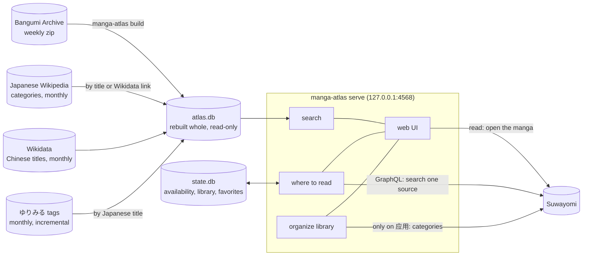

# Architecture

**English** | [简体中文](architecture.zh-CN.md)

MangaAtlas is one Python process (FastAPI) and two SQLite files. A build, by hand or weekly through the
optional timer, turns the Bangumi Archive into a read-only catalogue; the web app searches it instantly and asks Suwayomi, on demand,
which sources carry a work.

## Components

| Package | Does | How |
| --- | --- | --- |
| `build` | Builds `atlas.db` from the archive | Reads four files of the dump (subjects, their relations, their credits, and people). Keeps manga series plus standalone volumes that enough Bangumi users have collected; folds volumes into their series; drops R18. Writes a new file and swaps it in atomically. |
| `build` (vocabulary) | One set of tags | Official and user tags with their vote counts; drops noise and tags that are really people or publishers; folds Simplified and Traditional spellings together, and synonyms through a small alias table (`vocab.toml`). |
| `build/tagsources` | Extra tags | Japanese Wikipedia categories (matched by Wikidata's Bangumi ID, P5732, or by title) and ゆりみる's tags (matched by Japanese title), each cached under the data folder and refreshed monthly. A failed refresh keeps the old cache. |
| `query` | Search, suggestions, the work page, covers | FTS5 trigram for three or more characters, `LIKE` below that; tag filters as `INTERSECT` / `NOT IN`; facet counts per query. Covers come from the Bangumi API once and are cached. |
| `availability` + `match` | Where to read | Searches each source, compares the first results with the work's names, caches the answer (see below). |
| `suwayomi` | All Suwayomi access | GraphQL: search a source, fetch a manga and its chapters, read the library and categories. Nothing else talks to Suwayomi. |
| `library` | Organize the library (整理书架) | Plans categories from the included tags, writes them only when asked, and only adds. |
| `favorites` | 收藏 | A table in `state.db`; search can filter and sort by it. |
| `web` | The UI | Plain ES modules and CSS, no build step. Every view is a URL. |

## Where to read

The work page asks every source at once. 检查本页 goes through a page of works, asks the Chinese
sources first, and stops at a work's first ✓ or ≈. Either way a source gets one request at a time,
with a pause between requests, a short timeout, and a circuit breaker after repeated failures. Answers are cached: a hit
for weeks, a miss for days (`cache_hit_ttl_days`, `cache_miss_ttl_days`).

For each source MangaAtlas searches by one of the work's names (the original title for Japanese
sources; the Chinese title, then aliases, for Chinese ones), compares the top results, and stops at
the first match:

| Mark | Meaning |
| --- | --- |
| ✓ | Same work: the title matches, and either the author agrees or the title is long enough to trust alone (over `match_short_title_len` characters). |
| ≈ | Probably the same work: a short title matches but there is no author to compare, or the top result goes by another translation but has the same author. Counts as readable, shown in amber. |
| 同名不同作 | A short title matches but the author is someone else. Not readable, but listed so you can look. |

Only Bangumi's and Wikidata's names act as titles. A title a source lists under another translation
can only ever give ≈, and is used afterwards just as a search term on the other Chinese sources.
Editions (完全版, カラー版, …) count as the same work; side stories, art books and sequels do not.
The rules come from measured failures; `tests/fixtures/matching` holds the labelled cases.

## Data folder

Everything lives under `data_dir` (default `~/.local/share/manga-atlas`):

| Path | Contents |
| --- | --- |
| `atlas.db` | The catalogue, rebuilt whole by each build |
| `state.db` | What the app learns and keeps: availability cache, library mapping, favorites |
| `dumps/` | The latest Bangumi Archive zip |
| `covers/` | Cached covers |
| `jawiki/`, `wikidata/`, `yurimiru/` | Caches of the extra tag and title sources |

## Security

- Listens on `127.0.0.1` only and checks the `Host` header, which blocks DNS rebinding.
- Every request other than `GET` and `HEAD` needs an `X-Atlas: 1` header. Another site could only send it
  after a CORS preflight, which MangaAtlas never answers.
- Other sites may link to its pages but not embed, fetch or redirect into them (`Sec-Fetch-Site`),
  so they cannot make it fetch covers or start checks on their behalf.
- Stores no credentials.

## Tests

| Kind | Command | Needs |
| --- | --- | --- |
| Unit and integration | `uv run pytest` | Nothing; tests never reach the network |
| Browser end to end | `uv run pytest -m e2e tests/e2e` | Playwright's Chromium; uses a fake backend |
| Live | `uv run pytest -m live` | A real Suwayomi and the network; kept minimal |
