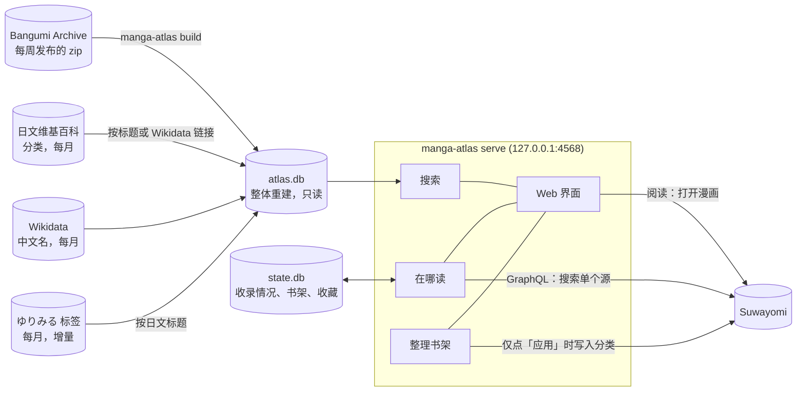

# 架构

[English](architecture.md) | **简体中文**

MangaAtlas 是一个 Python 进程（FastAPI）加两个 SQLite 文件。构建（手动运行，或由可选的定时器每周运行）把 Bangumi Archive 转成只读目录；Web 应用能即时搜索它，并按需向 Suwayomi 询问哪些源收录了某部作品。

## 组件

| 包 | 作用 | 实现 |
| --- | --- | --- |
| `build` | 从数据包构建 `atlas.db` | 读取数据包里的四个文件（条目、条目关联、条目人员、人物）。保留漫画系列，以及 Bangumi 收藏人数够多的独立单行本；把单行本并入所属系列；剔除 R18。写出一个新文件，再原子地替换进去。 |
| `build`（词表） | 一套统一的标签 | 官方标签和用户标签，带各自的票数；剔除噪声，以及实为人名或出版社名的标签；合并简体/繁体写法，并按一张小型别名表（`vocab.toml`）合并别名。 |
| `build/tagsources` | 额外标签 | 日文维基百科的分类（按 Wikidata 的 Bangumi ID，即 P5732，或按标题匹配）和 ゆりみる 的标签（按日文标题匹配），各自缓存在数据目录下，每月刷新一次。刷新失败时保留旧缓存。 |
| `query` | 搜索、联想、作品页、封面 | 三个及以上字符用 FTS5 trigram，更短的用 `LIKE`；标签筛选用 `INTERSECT` / `NOT IN`；每次查询都计算分面计数。封面只从 Bangumi API 取一次，然后缓存。 |
| `availability` + `match` | 在哪读 | 逐个搜索各个源，把前几条结果与作品的各个名称比对，并缓存答案（见下文）。 |
| `suwayomi` | 所有对 Suwayomi 的访问 | GraphQL：搜索某个源、获取漫画及其章节、读取书架和分类。其他部分都不与 Suwayomi 通信。 |
| `library` | 整理书架 | 根据已包含的标签规划分类，只在被要求时才写入，而且只加不删。 |
| `favorites` | 收藏 | `state.db` 里的一张表；搜索可以按它筛选和排序。 |
| `web` | 界面 | 纯 ES 模块和 CSS，没有构建步骤。每个视图都是一个 URL。 |

## 在哪读

作品页同时询问所有源；「检查本页」逐部检查整页作品，先问中文源，一部作品遇到第一个 ✓ 或 ≈ 就停。无论哪种，对每个源一次只发一个请求，请求之间有间隔，超时很短，连续失败后会熔断。答案会被缓存：找到的缓存数周，没找到的缓存数天（`cache_hit_ttl_days`、`cache_miss_ttl_days`）。

对每个源，MangaAtlas 用作品的某一个名称去搜索（日文源用原名；中文源先用中文名，再用别名），比对靠前的结果，遇到第一个匹配就停下：

| 标记 | 含义 |
| --- | --- |
| ✓ | 同一部作品：标题匹配，并且作者一致，或者标题足够长、单凭标题就足以信任（超过 `match_short_title_len` 个字符）。 |
| ≈ | 很可能是同一部作品：短标题匹配但没有作者可比对，或者排在最前的结果用的是另一种译名但作者一致。算作能读，以琥珀色显示。 |
| 同名不同作 | 短标题匹配，但作者是另一个人。不算能读，但会列出来供你查看。 |

只有 Bangumi 和 Wikidata 的名称才算作标题。源里以另一种译名列出的标题，最多只能得到 ≈，之后也只作为搜索词，拿到其他中文源上去搜。各种版本（完全版、カラー版……）算作同一部作品；番外、画集和续作则不算。这些规则来自实测中出现的失败；`tests/fixtures/matching` 里存放着带标注的用例。

## 数据目录

所有数据都放在 `data_dir` 下（默认是 `~/.local/share/manga-atlas`）：

| 路径 | 内容 |
| --- | --- |
| `atlas.db` | 目录，每次构建都整体重建 |
| `state.db` | 应用学到并保留的内容：收录情况缓存、书架映射、收藏 |
| `dumps/` | 最新的 Bangumi Archive zip |
| `covers/` | 缓存的封面 |
| `jawiki/`、`wikidata/`、`yurimiru/` | 额外的标签和标题来源的缓存 |

## 安全

- 只监听 `127.0.0.1`，并检查 `Host` 头，以此阻止 DNS 重绑定。
- 除 `GET`、`HEAD` 之外的每个请求都必须带 `X-Atlas: 1` 头。别的网站只有先发起 CORS 预检才能带上它，而 MangaAtlas 从不响应预检。
- 其他网站可以链接到它的页面，但不能嵌入、抓取或重定向到这些页面（`Sec-Fetch-Site`），因此无法让它代为获取封面或发起检查。
- 不保存任何凭据。

## 测试

| 类型 | 命令 | 需要 |
| --- | --- | --- |
| 单元与集成 | `uv run pytest` | 无；测试从不访问网络 |
| 浏览器端到端 | `uv run pytest -m e2e tests/e2e` | Playwright 的 Chromium；使用模拟后端 |
| Live（真实环境） | `uv run pytest -m live` | 真实的 Suwayomi 和网络；数量保持最少 |
